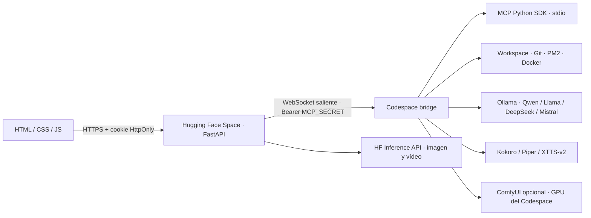

# Codespace Neon

Workspace privado que conecta una interfaz FastAPI en Hugging Face Spaces con un GitHub Codespace mediante un WebSocket saliente autenticado. Incluye chat Ollama, agente con diff y aprobación, editor, Git, terminal restringida, MCP stdio, TTS, generación de imágenes y una ruta opcional de ComfyUI/vídeo.

## Arquitectura



El navegador no recibe tokens de Hugging Face, GitHub ni MCP y no se conecta a Ollama. El Codespace abre la conexión hacia el Space; no hace falta publicar su puerto. El agente enseña un diff antes de aplicar cambios, y verifica que los archivos no hayan cambiado desde su revisión.

## Requisitos

- Python 3.11 recomendado para la aplicación y las dependencias opcionales de TTS.
- GitHub Codespace con Git. Docker, PM2, Node.js y Ollama son opcionales según las herramientas que se utilicen.
- Una cuenta Hugging Face. Para inferencia alojada, un token con permisos de lectura e inferencia; el permiso de escritura no es necesario para esta aplicación.
- Docker para desarrollo local o un Space con SDK Docker.

El Dockerfile instala `git`, `curl`, `ffmpeg`, Node.js y npm. En un Ubuntu/Codespace que necesite las herramientas de sistema, una persona administradora puede instalar `git curl wget unzip ffmpeg build-essential python3-pip python3-venv nodejs npm` con `apt`. No se requieren permisos `sudo` dentro del Space.

## Desarrollo local

```bash
python3 -m venv .venv
source .venv/bin/activate
python -m pip install --upgrade pip setuptools wheel
pip install -r requirements.txt
cp .env.example .env
chmod 600 .env
```

Edita `.env` en el editor local. Usa contraseñas propias, no guardes valores reales en Git y no pegues tokens en el chat. La aplicación requiere `APP_PASSWORD` de al menos 16 caracteres y `MCP_SECRET` de al menos 32. Para generar secretos aleatorios en el terminal:

```bash
openssl rand -hex 24
openssl rand -hex 32
```

Para una interfaz local sin HTTPS, configura `COOKIE_SECURE=false`. Inicia el servidor:

```bash
set -a
source .env
set +a
.venv/bin/uvicorn main:app --host 0.0.0.0 --port 7860 --reload
```

Abre `http://localhost:7860`. El healthcheck público está en `/health`; las demás rutas de trabajo requieren sesión.

## Ollama y Codespaces

Instala e inicia Ollama en el Codespace, configura `OLLAMA_HOST` para la dirección local de Ollama y descarga los modelos que quieras usar. Ejemplo:

```bash
ollama pull qwen2.5:7b
ollama pull llama3.2
ollama pull deepseek-coder-v2
ollama pull mistral
```

Los nombres que aparecen en el selector se descubren con `/api/tags`; solo se mostrarán modelos que ya estén disponibles en Ollama. La interfaz prioriza Qwen para chat y DeepSeek para programación, y también admite los modelos Dolphin. DeepSeek-Coder-V2 y los modelos de 7B pueden necesitar bastante memoria. Descarga únicamente los que admita tu Codespace.

```bash
ollama pull qwen2.5:7b
ollama pull deepseek-coder-v2
ollama pull dolphin-llama3
ollama pull dolphin-mistral
ollama pull mistral:7b
```

También se aceptan los alias `qwen`, `deepseek`, `dolphin` y `mistral` en el API. Puedes fijar sus etiquetas de Ollama con `QWEN_MODEL`, `DEEPSEEK_MODEL`, `DOLPHIN_MODEL` y `MISTRAL_MODEL`.

En **Hugging Face → Space → Settings → Variables and secrets**, configura:

- `APP_PASSWORD`: contraseña de la interfaz, mínimo 16 caracteres.
- `MCP_SECRET`: secreto aleatorio compartido, mínimo 32 caracteres.
- `HF_TOKEN`: opcional para inferencia Hugging Face de imagen/vídeo; no se envía al navegador.
- `TRUSTED_HOSTS`: opcional; lista separada por comas de nombres de host permitidos.
- `AGENT_MODEL`: opcional; por defecto `deepseek-coder-v2`.
- `TELEGRAM_BOT_TOKEN` y `TELEGRAM_ADMIN_IDS`: opcionales para habilitar login privado de Telegram Mini App. `TELEGRAM_ADMIN_IDS` es una lista separada por comas de IDs numéricos.

En el Codespace configura el mismo `MCP_SECRET`, además de `OLLAMA_HOST`. `HF_TOKEN` también se puede configurar allí para llamar a la inferencia desde las herramientas MCP. Git utiliza las credenciales ya asociadas al Codespace; `GITHUB_TOKEN` no se necesita para `git push` y el proyecto no lo lee.

Inicia el puente en el Codespace y deja el proceso activo:

```bash
python -m codespace.bridge connect --url wss://<tu-space>.hf.space/ws/bridge
```

El estado debe cambiar a **Conectado** en el panel MCP. Los Codespaces pueden suspenderse al quedar inactivos; vuelve a iniciar el puente al reanudarlos. No publiques `MCP_SECRET` ni abras un túnel entrante para Ollama.

## Telegram Mini App opcional

El login de Telegram no requiere guardar usuarios ni crea acceso para cuentas arbitrarias. En BotFather crea/configura el bot y su botón de Mini App apuntando a `https://<tu-space>.hf.space`. Añade `TELEGRAM_BOT_TOKEN` y `TELEGRAM_ADMIN_IDS` a los secretos del Space. El backend valida la firma HMAC de `initData`, requiere un `auth_date` de menos de cinco minutos y compara el ID con la allowlist; nunca confía en `initDataUnsafe` del navegador. La contraseña del Space continúa disponible como acceso alternativo.

El token del bot es un secreto de servidor. No habilites Mini Apps públicas mientras uses este workspace como consola de administración.

## MCP en VS Code

Tras crear `.venv` e instalar `requirements.txt`, VS Code detecta `.vscode/mcp.json`. Activa el servidor MCP `codespace-neon` desde la vista MCP. Para una conexión independiente desde un cliente local, ejecuta:

```bash
.venv/bin/python -m codespace.bridge mcp
```

El servidor MCP oficial `mcp.server.fastmcp.FastMCP` expone lectura/escritura/borrado/listado de archivos, carpetas, terminal restringida, Git, PM2, Docker, sistema, Ollama, TTS, generación/edición/upscale/caption de imágenes y generación de vídeo. Las rutas se limitan al workspace; `.env`, `.git`, `.ssh`, entornos virtuales y `node_modules` no son accesibles por archivo.

## TTS local opcional

TTS se ejecuta en el Codespace para no instalar modelos grandes en la imagen estándar del Space. En un entorno Python 3.11 dedicado:

```bash
pip install -r requirements-tts.txt
```

Instala un modelo Piper compatible y configura `PIPER_MODEL` con su ruta local. Kokoro permite configurar `KOKORO_LANG` y `KOKORO_VOICE`; XTTS-v2 descarga su modelo en el primer uso. MP3 requiere `ffmpeg`. La generación solo estará disponible mientras el Codespace siga conectado.

## Imagen, vídeo y ComfyUI

Image Studio admite FLUX.1 Schnell, SDXL y Juggernaut XL a través de Hugging Face Inference. Requiere `HF_TOKEN`, que el proveedor tenga habilitado para el modelo y que el token tenga acceso si el modelo lo requiere. Esta integración es inferencia remota: no descarga pesos al contenedor. La licencia, cuota y disponibilidad dependen del proveedor y del modelo.

La integración local opcional con Diffusers requiere una GPU y una instalación separada:

```bash
pip install -r requirements-local-image.txt
```

Vídeo (Wan 2.2, CogVideoX y Hunyuan) suele requerir una GPU de alto rendimiento y memoria considerable. La API intentará primero los modelos disponibles por Hugging Face Inference y devolverá un error explícito si no están publicados allí o requieren un endpoint dedicado.

Para usar ComfyUI, instala ComfyUI y los modelos/nodos por separado en un equipo GPU. Exporta el workflow en formato **API**, configura `COMFYUI_URL`, `COMFYUI_IMAGE_WORKFLOW` y/o `COMFYUI_VIDEO_WORKFLOW` en el proceso que ejecuta la generación, e identifica el nodo y campo del prompt mediante `COMFYUI_PROMPT_NODE_ID` y `COMFYUI_PROMPT_INPUT`. Las herramientas MCP lanzadas en Codespaces usan la configuración del Codespace; una Space no puede acceder a `localhost` del Codespace. Los clips y las imágenes generados por las herramientas MCP se pueden guardar dentro de `assets/`.

Image Studio permite descargar, enviar la tarea al agente y guardar en `assets/`. Para versionar el medio, realiza un commit Git deliberadamente desde la pestaña Git. No se crean commits automáticos.

## Docker y Hugging Face Spaces

Desarrollo local con Compose:

```bash
cp .env.example .env
# Edita .env con secretos locales.
docker compose up --build
```

Abre `http://localhost:7860`. Compose usa `host.docker.internal` para acceder a Ollama del host Linux; ajusta `OLLAMA_HOST` en `.env` si Ollama está en otra dirección.

Para Hugging Face:

1. Crea un Space nuevo con SDK **Docker**.
2. Sube el repositorio completo; `README.md` contiene también los metadatos de Space.
3. Añade los secretos en **Settings → Variables and secrets**. No subas `.env`.
4. Añade `HF_TOKEN` solo si usarás modelos de inferencia alojados.
5. Espera al build y abre el Space. El contenedor escucha en el puerto `7860`.
6. Inicia el puente desde el Codespace según la sección anterior.

El comando de inicio del Space es `uvicorn main:app --host 0.0.0.0 --port 7860`. El healthcheck está en `/health`.

## API

Todas las rutas `/api/*` salvo `/api/login` y `/api/session` requieren cookie de sesión. El backend también ofrece estos alias de compatibilidad:

| Método | Ruta | Uso |
|---|---|---|
| `POST` | `/api/login` | Iniciar sesión |
| `GET` | `/api/models` | Modelos disponibles en Ollama |
| `POST` | `/chat` o `/api/chat` | Chat con un modelo local |
| `POST` | `/agent` o `/api/agent` | Proponer, aplicar o descartar un plan revisado |
| `GET/POST/DELETE` | `/api/files` | Listar, guardar o borrar archivos |
| `GET` | `/api/files/read` | Leer archivo de texto |
| `POST` | `/api/files/folder` | Crear carpeta |
| `POST` | `/api/terminal` | Ejecutar comando allowlist |
| `GET/POST` | `/api/git` | Estado, commit y push explícito |
| `POST` | `/tts` o `/api/tts` | Generar voz mediante el Codespace |
| `POST` | `/image` o `/api/image` | Generar PNG |
| `POST` | `/api/image/edit` | Editar imagen subida |
| `POST` | `/video` o `/api/video` | Generar vídeo MP4 |
| `POST` | `/api/media/save` | Guardar medios base64 en `assets/` |
| `GET/POST` | `/api/mcp` | Consultar herramientas o invocar una operación |
| `GET` | `/api/system` | Estado del Codespace, Ollama, CPU, RAM y disco |
| `WS` | `/ws` | Estado en vivo del puente, con sesión |
| `WS` | `/ws/bridge` | Canal Codespace autenticado con Bearer |

Chat acepta `{"model":"qwen2.5:7b","messages":[{"role":"user","content":"Hola"}]}` o `{"model":"qwen","message":"Hola"}`. Image Studio acepta `{"prompt":"cyberpunk AI dashboard","model":"flux"}`. Los motores de vídeo se indican con `wan`, `cogvideox` o `hunyuan`.

La terminal no usa un shell; solo acepta `npm install`, `pip install`, órdenes Git seleccionadas, PM2, `docker ps`, `ls`, `pwd` y `whoami`. No acepta pipes, redirecciones ni expansión de shell. `npm install` puede ejecutar scripts de los paquetes y debe usarse con dependencias de confianza.

## Desarrollo y pruebas

```bash
.venv/bin/python -m unittest discover -s tests -v
.venv/bin/python -m compileall -q main.py app codespace
node --check app/static/app.js
```

La suite prueba sesiones, login, allowlist de comandos, traversal, enlaces simbólicos, secretos, binarios y catálogo MCP. La generación real de modelos necesita credenciales, cuotas y proveedores configurados; no forma parte de las pruebas offline.
